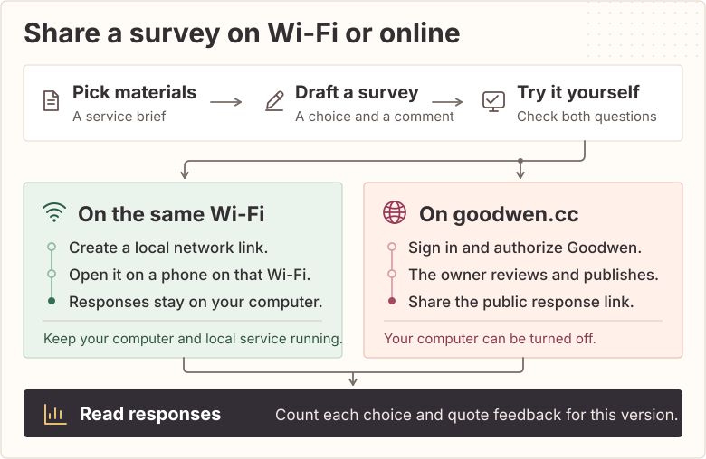
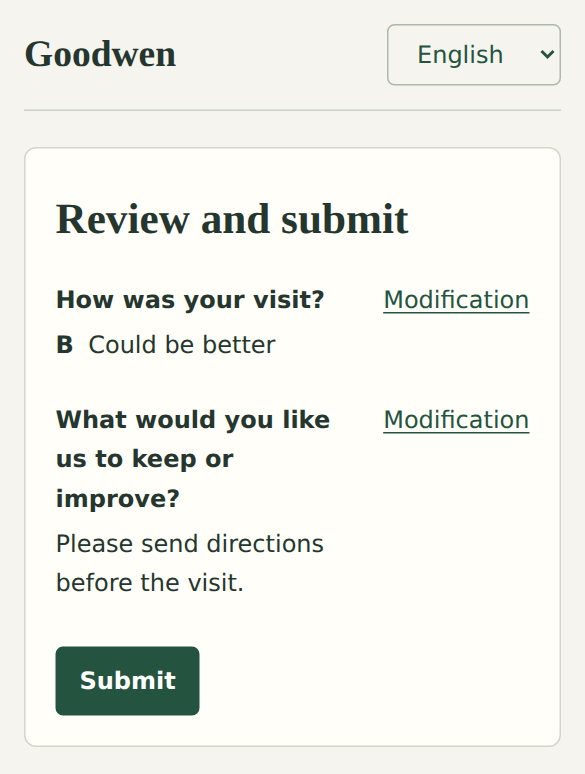

<h1 align="center"> Goodwen</h1>

<a href="README.md" lang="zh-CN">简体中文</a> · <strong>English</strong>

Goodwen turns material you give your AI agent into a survey. Try it yourself, share it with respondents, then ask the agent what their answers tell you. Codex can collect responses on your Wi-Fi. Publish to goodwen.cc to reach people elsewhere and keep collecting after you turn off your computer.

[Install in Codex](#local-codex) · [Connect ChatGPT or WorkBuddy](#chatgpt-and-workbuddy) · [Sign up or sign in to Goodwen](https://goodwen.cc/login?lang=en)

## Create your first survey

### Local Codex

Open the [Goodwen installation guide for Codex](https://goodwen.cc/agents/codex?lang=en#install), copy the installation prompt for the current release and paste it into local Codex. The first validation requires internet access and reports the sample survey title and two questions.

Start a new Codex session and try this prompt. To work with your own material, attach it and tell the agent who will answer and what you want to learn.

> Use $goodwen to copy the bundled service visit feedback example into my working directory. Validate and save it, then give me the author preview link.

Open the link and select **English** to try the example as a respondent. Answer both questions and review your answers before submitting. Goodwen records previews separately from responses collected through a shared link. To revise a question, describe the change in chat and open the new preview.

Offline installation for Windows, macOS or Linux

On a computer with internet access, download the ZIP for the computer that will run Goodwen. Each offline package includes its runtime. [Windows x64](https://github.com/goodwen-cloud/goodwen/releases/latest/download/goodwen-windows-x64.zip) · [macOS on Apple Silicon](https://github.com/goodwen-cloud/goodwen/releases/latest/download/goodwen-macos-arm64.zip) · [Linux x64 with glibc](https://github.com/goodwen-cloud/goodwen/releases/latest/download/goodwen-linux-x64.zip)

Extract the ZIP and copy the entire `goodwen` folder into your Codex skills directory. The default is `%USERPROFILE%\.codex\skills\` on Windows and `~/.codex/skills/` on macOS and Linux. Start a new session and use the preview prompt above.

### ChatGPT and WorkBuddy

Add Goodwen through your client's plugin or connector settings, then sign up or sign in on goodwen.cc and authorize the connection. For manual MCP setup, use `https://goodwen.cc/mcp` with OAuth. If your client supports ZIP import, use the matching package.

| Client | Setup guide | Latest package |
| --- | --- | --- |
| ChatGPT | [Connect ChatGPT](https://goodwen.cc/agents/chatgpt?lang=en) | [Download the ChatGPT ZIP](https://github.com/goodwen-cloud/goodwen/releases/latest/download/goodwen-chatgpt.zip) |
| WorkBuddy | [Connect WorkBuddy](https://goodwen.cc/agents/workbuddy?lang=en) | [Download the WorkBuddy ZIP](https://github.com/goodwen-cloud/goodwen/releases/latest/download/goodwen-workbuddy.zip) |

Select Goodwen in the chat and try this prompt. Once you choose a workspace, the agent can give you a review link for the online draft.

> List my Goodwen workspaces. After I choose one, create an unscored survey in English about a service visit. Ask “How was your visit?” with the choices “Good” and “Could be better”. Then ask “What would you like us to keep or improve?” Give me the draft review link.

## Share your survey

<picture>
  <source media="(max-width: 600px)" srcset="docs/media/survey-flow-mobile.en.svg">
  
</picture>

### Publish to goodwen.cc

1. **Open the draft for review.** In a local Codex preview, choose **发布到 Goodwen，获取公网链接** (publish to Goodwen). On first connection, check which local surveys and future edits will be saved to your personal workspace, then sign in and authorize Goodwen. In ChatGPT or WorkBuddy, open the draft review link from the conversation.
2. **Approve the version.** The workspace owner checks the questions, choices and scoring on the Goodwen review page and selects **Publish**.
3. **Share the respondent link.** In the local preview, choose **我已审核，获取链接** (get the link after review). In an online chat, ask “Create a public response link for the version I just approved.” Send that link to your respondents. You can open it on another device to check what they will see.

Codex reuses a valid Goodwen authorization across sessions in the same user profile. Earlier local responses stay on the original computer. To import a batch, check its destination workspace, published version and response count, then confirm. [Illustrated publishing steps](docs/media/publish-guide.en.svg) · [Web review guide](https://goodwen.cc/help/review-and-distribute?lang=en)

### Collect responses on the same Wi-Fi

In the local author preview, choose **在局域网发放** (share on the local network). Send the full address it generates to people on the same network. They can open it on their phones, answer the questions and submit. Keep the host computer and the local service running while people respond. The `127.0.0.1` preview address works only on the author's computer.

See how a respondent reviews their answers on a phone

## Read the responses

In local Codex or the Goodwen workspace where you shared the survey, tell the agent which version to use.

- **Export local responses to CSV.** “Count how many people chose each option in this version. Include their written comments and export the responses to `feedback.csv` in my working directory.”
- **Analyze online responses.** “Read the responses to the service visit survey I just published. Rank the suggested improvements by how many people mentioned them. Include the question and a respondent quote for each.”

## Guides and source

- The [illustrated local guide (Chinese)](docs/guide.md) includes screenshots, terminal commands and upgrade instructions. For online results, see the [response analysis guide](https://goodwen.cc/help/read-and-analyze?lang=en).
- The local runtime and sample survey live in [skills/goodwen](skills/goodwen/). The [ChatGPT](packages/chatgpt/) and [WorkBuddy](packages/workbuddy/) packages use the same skill with client-specific connection settings.
- To build from source, use Python 3.12. GitHub Actions builds and verifies all five packages. [Build instructions (Chinese)](docs/build-plan.md) · [Latest release](https://github.com/goodwen-cloud/goodwen/releases/latest) · [SHA-256 checksums](https://github.com/goodwen-cloud/goodwen/releases/latest/download/SHA256SUMS)

[Apache-2.0 license](LICENSE) · [Third-party notices](NOTICE)
