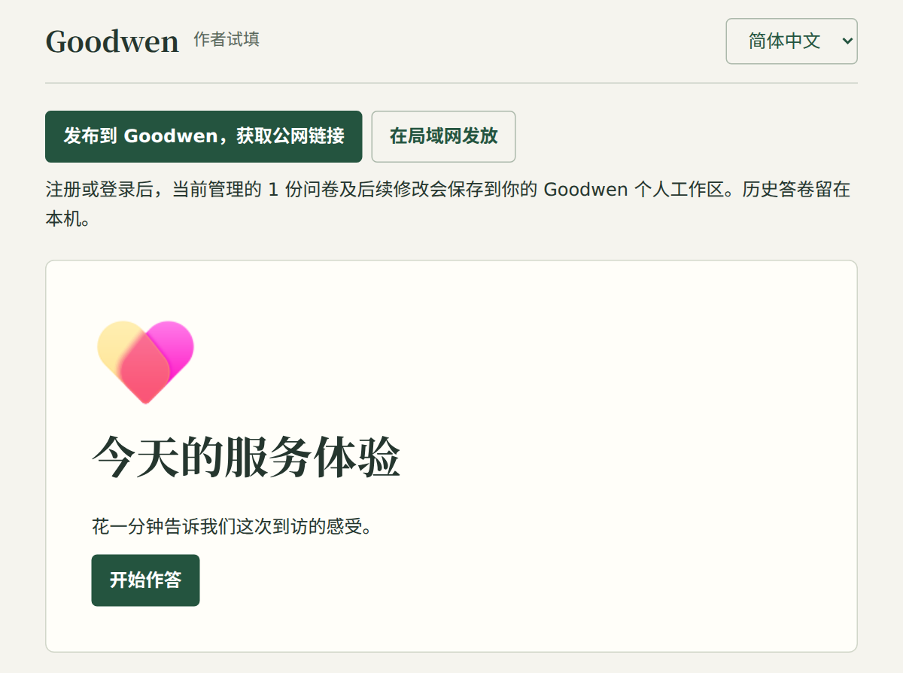
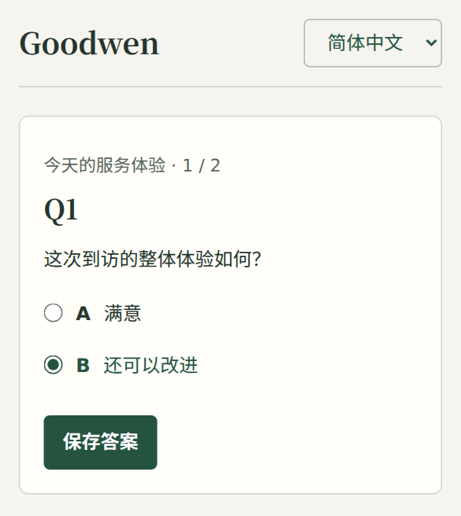
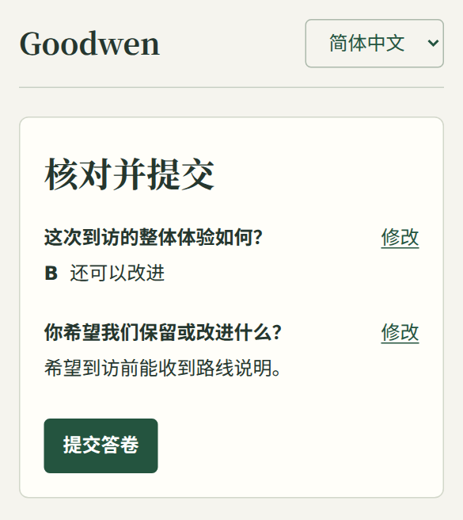

<h1 align="center"> Goodwen</h1>

用 Goodwen 把手里的材料做成问卷，在智能体里查看填写者的真实回答。你可以先在电脑上试填，让同一 Wi-Fi 下的同事现场作答，也可以把问卷发布到 goodwen.cc，让外部客户用手机填写。

**[下载安装包](https://github.com/goodwen-cloud/goodwen/releases/latest)**　·　**[注册或登录 Goodwen](https://goodwen.cc/login)**　·　[完整图文教程](docs/guide.md)

<picture>
  <source media="(max-width: 600px)" srcset="docs/media/survey-flow-mobile.svg">
  
</picture>

## 安装或连接 Goodwen

### 本地 Codex

1. 下载适合电脑的离线包。[Windows x64](https://github.com/goodwen-cloud/goodwen/releases/latest/download/goodwen-windows-x64.zip) · [macOS Apple Silicon](https://github.com/goodwen-cloud/goodwen/releases/latest/download/goodwen-macos-arm64.zip) · [Linux x64（glibc）](https://github.com/goodwen-cloud/goodwen/releases/latest/download/goodwen-linux-x64.zip)
2. 解压，把整个 `goodwen` 文件夹复制到 Codex 技能目录。Windows 放入 `%USERPROFILE%\.codex\skills\`，macOS 和 Linux 放入 `~/.codex/skills/`。打开复制后的文件夹，应能看到 `SKILL.md`、`scripts/` 和 `examples/`。包里已附本地运行环境。
3. 新开一个 Codex 会话，输入下面这句话。智能体会给你一个能在本机浏览器打开的作者试填链接。

> 用 $goodwen 把自带的《服务体验回访》示例复制到当前工作目录。校验并保存问卷，给我作者试填链接。

也可以直接附上自己的材料，说明想问谁、想弄清什么，并让智能体给你试填链接。

### ChatGPT 和 WorkBuddy

1. 从宿主的插件或连接器入口添加 Goodwen。使用手动 MCP 连接时填入 `https://goodwen.cc/mcp`，验证方式选 OAuth。支持导入包的入口可以直接下载对应 ZIP。[ChatGPT 连接指引](https://goodwen.cc/agents/chatgpt) · [ChatGPT ZIP](https://github.com/goodwen-cloud/goodwen/releases/latest/download/goodwen-chatgpt.zip) · [WorkBuddy 连接指引](https://goodwen.cc/agents/workbuddy) · [WorkBuddy ZIP](https://github.com/goodwen-cloud/goodwen/releases/latest/download/goodwen-workbuddy.zip)
2. 在 Goodwen 授权页注册或登录，确认权限后回到对话，选择 Goodwen。让智能体「列出我可以使用的 Goodwen 工作区」，然后选定问卷要放入的工作区。
3. 发下面这句话。收到在线草稿的审核链接后，直接跳到本文的[发布到 goodwen.cc](#发布到-goodwencc)。

> 在选定的工作区创建一份服务体验回访。第一题问整体体验，选项是「满意」「还可以改进」。第二题问「你希望我们保留或改进什么？」两题都不计分。请给我审核链接。

## 先在电脑上试填

打开 Codex 返回的作者试填链接，点「开始作答」，选一个答案并保存，再填写第二题。走完两题，检查措辞、选项和提交后的结束语。想改题时，把修改告诉智能体，再打开它返回的新版本。作者试填单独保存，正式收卷使用发放链接。

## 在同一 Wi-Fi 下收卷

1. 回到作者试填页，点「在局域网发放」。把按钮下方出现的完整地址发给同一网络中的同事。收卷期间保持电脑和本地服务运行。
2. 填写者在手机或电脑上打开地址，点「开始作答」。选择答案后点「保存答案」，填写第二题的建议，再次保存。
3. 在「核对并提交」页检查每道题和自己的回答。需要改时，点该题右侧的「修改」，重新保存。点「提交答卷」，看到「谢谢，你的反馈已收到。」即已完成这份回访。

  
  

手机打不开时，检查两台设备是否在同一局域网，并重新复制「在局域网发放」给出的地址。`127.0.0.1` 是发起人电脑自己的试填地址。

## 发布到 goodwen.cc

客户在外地，或你需要关机后继续收卷时，可以把问卷放到 goodwen.cc，用公网填写链接发放。

1. **打开在线草稿。** 本地用户在作者试填页点「发布到 Goodwen，获取公网链接」。首次发布会列出将保存到个人工作区的本机问卷数量，确认范围后通过 Codex 连接 Goodwen，按提示注册或登录并授权。ChatGPT 和 WorkBuddy 用户直接打开对话里返回的草稿审核链接。
2. **由负责人确认发布。** 在 Goodwen 网页核对本版的题目、选项和计分设置，再点「确认发布」。需要改题时，回到智能体改稿并重新审核。[网页审核与发放指引](https://goodwen.cc/help/review-and-distribute)
3. **取得填写链接。** 本地用户回到作者试填页，点「我已审核，获取链接」。在 ChatGPT 或 WorkBuddy 里可以说「为刚才批准的版本创建公开填写链接」。把**公网填写链接**发给客户，审核链接留给负责人。
4. 用另一台设备打开填写链接，按提示完成作答。发布后由 goodwen.cc 持续收卷，发起人的电脑可以关机。已有的本地答卷保存在原设备，需要导入时另行选择工作区、问卷版本和批次并确认。

## 查看回答或导出 CSV

**本地收卷**后，回到 Codex，指定刚才发放的版本和导出位置。

> 查看这一版服务回访的正式答卷，列出每个选项的人数，把简答原文一起导出到当前目录的 feedback.csv。

**公网收卷**后，在已连接 Goodwen 的智能体里选定同一工作区。问卷改过题时，指明要分析哪次发放的版本。

> 查看刚刚发布的服务回访，统计有多少人满意、多少人希望改进。把最常见的改进建议按人数排列，每条附上对应题目和填写者原话。

同一份 Codex 用户配置会复用有效的 Goodwen 授权。换设备或宿主时，在对应宿主重新连接。终端操作、选网卡和旧版升级见[完整操作教程](docs/guide.md)，在线答卷的筛选与分析见[官网指引](https://goodwen.cc/help/read-and-analyze)。

## 源码与发布

技能正文、本机运行器和示例在 [skills/goodwen](skills/goodwen/)。[ChatGPT](packages/chatgpt/) 与 [WorkBuddy](packages/workbuddy/) 使用同一份技能正文和各自的 MCP 配置。GitHub Actions 在 Windows、macOS 和 Linux 上构建并验证本机运行器。新版本通过后自动发布五个安装包及 [SHA-256 校验清单](https://github.com/goodwen-cloud/goodwen/releases/latest/download/SHA256SUMS)。

开发使用 Python 3.12。构建命令与发布规则见[构建与验收说明](docs/build-plan.md)。本项目采用 [Apache-2.0](LICENSE)，代码和依赖来源见 [NOTICE](NOTICE)。
