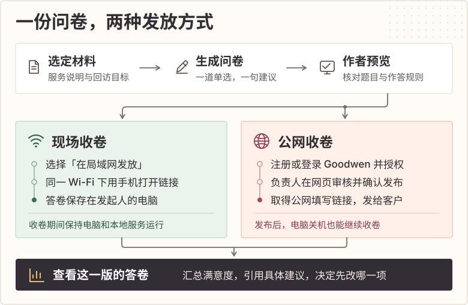

<h1> Goodwen 顾得问</h1>

**在你熟悉的智能体里，把工作资料做成问卷，发给真正要回答的人。** 你可以在电脑上试填，让同一 Wi-Fi 下的同事当场回答，也可以把问卷发布到 goodwen.cc，发给客户。收卷后回到对话，按这一版的真实回答整理建议。

**[下载 Goodwen](https://github.com/goodwen-cloud/goodwen/releases/latest)**　·　**[注册并打开 Goodwen](https://goodwen.cc/login)**　·　[跟着图文教程做一遍](docs/guide.md)

## 从一份服务回访开始

在本地 Codex 安装后，可以把这段话发给智能体。

> 用 $goodwen 把自带的《服务体验回访》复制到当前目录，打开让我试填。我想知道客户对这次到访是否满意，以及最希望我们改进什么。

你会得到一份带选择题和简答题的问卷。试填后可以决定在哪里收卷。

<picture>
  <source media="(max-width: 600px)" srcset="docs/media/survey-flow-mobile.svg">
  
</picture>

## 选一个入口

| 你在哪里工作 | 从这里开始 |
| --- | --- |
| **本地 Codex** | 下载 [Windows x64](https://github.com/goodwen-cloud/goodwen/releases/latest/download/goodwen-windows-x64.zip) · [macOS Apple Silicon](https://github.com/goodwen-cloud/goodwen/releases/latest/download/goodwen-macos-arm64.zip) · [Linux x64（glibc）](https://github.com/goodwen-cloud/goodwen/releases/latest/download/goodwen-linux-x64.zip)。解压后把 `goodwen/` 放进技能目录，新会话里用 `$goodwen` 调用。安装包自带本地运行环境。 |
| **ChatGPT** | 按[连接指引](https://goodwen.cc/agents/chatgpt)添加 Goodwen 并授权，在会话中选用 Goodwen 创建在线草稿。使用插件包导入入口时下载 [ChatGPT ZIP](https://github.com/goodwen-cloud/goodwen/releases/latest/download/goodwen-chatgpt.zip)。 |
| **WorkBuddy** | 按[连接指引](https://goodwen.cc/agents/workbuddy)在 MCP 或连接器管理中连接 Goodwen，在工作区内发放和分析。使用连接器包导入入口时下载 [WorkBuddy ZIP](https://github.com/goodwen-cloud/goodwen/releases/latest/download/goodwen-workbuddy.zip)。 |

## 把问卷发出去

**同事就在现场**　打开作者试填页，选「在局域网发放」，把返回的地址分享给同一网络的填写者。收卷期间保持电脑和本地服务运行，结束后可导出 CSV。

**客户在别处**　选「发布到 Goodwen，获取公网链接」。首次使用时注册或登录，负责人在网页核对题目并确认发布，再把公网填写链接发给客户。问卷由 goodwen.cc 承载，关机后也能继续收卷。[打开 Goodwen](https://goodwen.cc/login)

**开始看回答**　回到智能体说「查看这一版回访的正式答卷。列出满意和希望改进的人数，引用填写者原话，帮我找出最该先改的一项。」历史本地答卷可以单独选择导入。[完整操作教程与界面截图](docs/guide.md)

## 源码与发布

技能正文、本机运行器和示例在 [skills/goodwen](skills/goodwen/)。[ChatGPT](packages/chatgpt/) 与 [WorkBuddy](packages/workbuddy/) 使用同一份正文和各自的 MCP 配置。GitHub Actions 自动构建五个安装包，并在对应系统上验证本机运行器。`main` 的新版本通过后自动发布，提供稳定下载地址和 [SHA-256 校验清单](https://github.com/goodwen-cloud/goodwen/releases/latest/download/SHA256SUMS)。

开发使用 Python 3.12。构建命令与发版规则见[构建与验收说明](docs/build-plan.md)。本项目采用 [Apache-2.0](LICENSE)，代码和依赖来源见 [NOTICE](NOTICE)。
