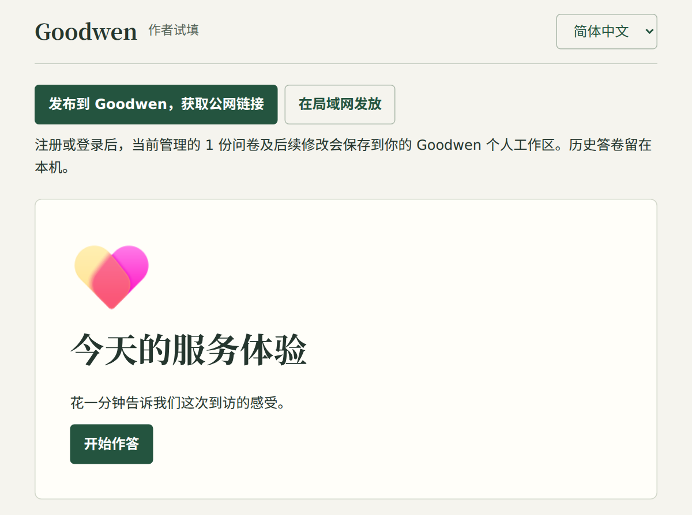
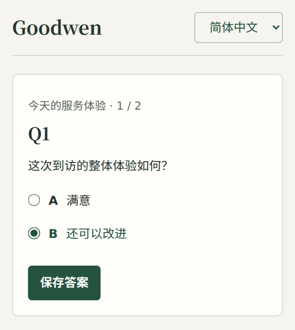
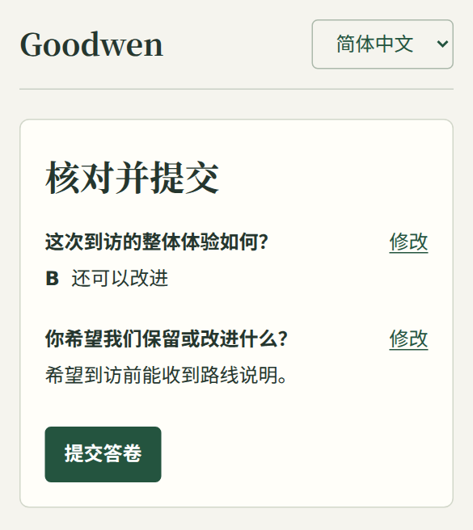
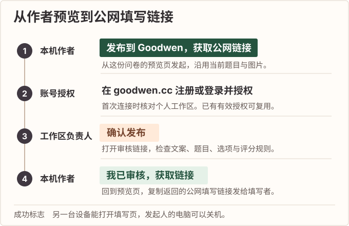

# 用 Goodwen 发出第一份问卷

跟着《服务体验回访》走一遍。问卷有两道不计分的题，一道问整体是否满意，一道请填写者说说希望保留或改进什么。最后你能看到实际回答，并选择导出或继续在对话中分析。

## 安装并找到 Goodwen

**本机 Codex**

1. 在[下载页](https://github.com/goodwen-cloud/goodwen/releases/latest)选择与你电脑对应的 ZIP。Windows 用 `windows-x64`，Apple Silicon Mac 用 `macos-arm64`，使用 glibc 的 Linux x64 用 `linux-x64`。
2. 解压，复制里面整个 `goodwen` 文件夹。macOS / Linux 放入 `~/.codex/skills/`，Windows 放入 `%USERPROFILE%\.codex\skills\`。完成后应能看到 `skills/goodwen/SKILL.md`，同一目录下有 `scripts/` 和 `examples/`。
3. 打开新的 Codex 会话，输入下面这句话。本地包已经包含对应系统的 Python 和依赖，离线也能校验、试填和收卷。根据材料写题的对话使用宿主模型。

> 用 $goodwen 把自带的服务回访示例复制到当前工作目录。校验并保存问卷，给我作者试填链接。

**ChatGPT 或 WorkBuddy**

1. 打开宿主的插件、MCP 或连接器管理，选择 Goodwen 连接。手动添加时，服务地址填 `https://goodwen.cc/mcp`，身份验证选择 OAuth。支持导入包的入口使用下载页中对应宿主的 ZIP。[ChatGPT 界面指引](https://goodwen.cc/agents/chatgpt) · [WorkBuddy 界面指引](https://goodwen.cc/agents/workbuddy)
2. 从宿主打开 Goodwen 的授权页，注册或登录，核对权限后返回。新建会话，选择 Goodwen，让它「列出我可以使用的 Goodwen 工作区」。看到工作区名称即已连接。
3. 在目标工作区说「创建一份服务体验回访。第一题询问整体体验，选项为满意、还可以改进。第二题收集希望保留或改进的地方。两题均不计分，请把审核链接给我。」得到线上草稿后，直接继续下文的**网页审核与发放**。

## 先用作者视角试填

打开本机运行器返回的作者试填链接。页面上方有「作者试填」标记和两种发放操作。下方是填写者会看到的欢迎页。点「开始作答」，走完两题，检查题目、选项和结束语。需要改题时直接告诉智能体，再打开它返回的新版本。



作者试填单独保存。要验证正式收卷，请让另一位填写者打开下一步生成的发放链接。

## 在同一 Wi-Fi 下现场收卷

1. 回到作者预览，点「在局域网发放」。复制按钮下方出现的完整地址，在同一局域网内的另一台电脑或手机上打开。
2. 填写者点「开始作答」，选择一项，点「保存答案」。第二题输入自己的建议，再次保存。
3. 在「核对并提交」页检查每道题、选中的选项和简答原文。要改某一题，点它右侧的「修改」，调整答案后点「保存答案」即可回到核对页。确认后点「提交答卷」，看到「谢谢，你的反馈已收到。」即已完成这份回访。保持发起人的电脑和本地服务运行，直到大家填完。

<p align="center">
  
  
</p>

手机无法打开时，确认它和电脑连接同一网络，复制的是「在局域网发放」生成的地址。以 `127.0.0.1` 开头的作者预览地址只在发起人的电脑上使用。多网卡电脑可以让智能体用 `share <snapshot_id> --address <本机局域网 IPv4>` 选择网卡。

## 网页审核与发放

外部客户、跨网络填写或关机后也需要收卷时，将这份问卷发布到 goodwen.cc。本机从作者预览开始，ChatGPT 和 WorkBuddy 从已返回的在线草稿审核链接开始。



1. **本机发起。** 点「发布到 Goodwen，获取公网链接」。首次连接时核对将保存到个人工作区的问卷范围，按提示在 Goodwen 注册或登录并授权。本机发布通过 Codex 的 MCP 连接完成。[打开 Goodwen](https://goodwen.cc/login)
2. **负责人审核。** 打开该草稿的审核链接，看清题目、选项和计分设置。需要修改时回到智能体改稿，再核对新版本。确定可以发给填写者后，在 Goodwen 网页点「确认发布」。[审核与发放指引](https://goodwen.cc/help/review-and-distribute)
3. **获取填写链接。** 本机回到作者预览，点「我已审核，获取链接」。ChatGPT 或 WorkBuddy 则在原对话里说「为刚刚批准的版本创建公开填写链接」。将返回的**公网填写链接**发给客户，审核链接留给负责人。
4. **用另一台设备试开。** 填写者看到这份问卷的作答说明，按该入口要求完成验证并提交。发布后由 Goodwen 持续收卷，发起人的电脑可以关机。之前在本机收集的回答仍保存在原设备，导入历史答卷时另行确认工作区、版本和数量。

## 查看答卷并决定下一步

本地收卷后，用这句话导出答案。

> 查看刚才这一版的正式答卷，列出每个选项的人数，把简答原文一起导出为当前目录的 feedback.csv。

公网收卷后，用这句话在同一个工作区总结回答。

> 到 Goodwen 查看刚发布的服务回访。汇总目前已提交的回答，为每条改进建议附上对应的题目和原话。样本少时请同时写出人数。

只收了一份时，应能看到那位填写者选择的选项和提交的简答。后续修改过题目时，先指定发放时的版本。网上的回答可在已授权的其他宿主查看。[查看与分析答卷](https://goodwen.cc/help/read-and-analyze)

## 本地运行命令

需要核对某一步时，可以直接使用技能目录内的启动器。以下命令从复制出的示例问卷所在目录运行。把保存回执里的 `snapshot_id` 粘贴给 `snapshot`，再预览或导出。

```sh
runner="$HOME/.codex/skills/goodwen/scripts/run.sh"
sh "$runner" validate ./quiz.md
sh "$runner" save ./quiz.md
snapshot='粘贴刚才返回的 snapshot_id'
sh "$runner" preview "$snapshot"
sh "$runner" results "$snapshot" --format csv --output feedback.csv
```

Windows PowerShell 使用同一组参数。下面的命令会校验这份问卷。

```powershell
$runner = Join-Path $env:USERPROFILE '.codex\skills\goodwen\scripts\run.ps1'
powershell -NoProfile -ExecutionPolicy Bypass -File $runner validate .\quiz.md
```

升级旧版 `goodwen-local` 时，先停止原本地服务，再用 `goodwen/` 替换技能目录。本地问卷与答卷存放在独立的用户数据目录。有效的 MCP 授权由同一份 Codex 用户配置复用，换设备或宿主时在对应宿主重新连接。
